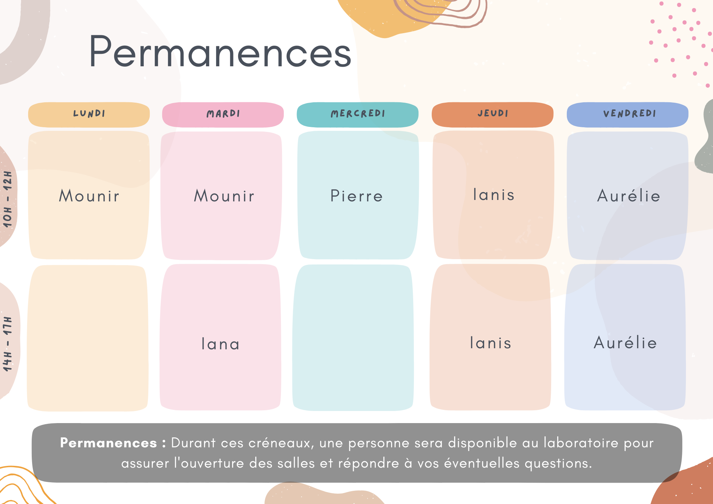

# Emplois du temps

Les emplois du temps sont disponibles sur la plateforme ADE de l'université, accessible via <a href="https://ent.univ-fcomte.fr" target="_blank">l'ENT</a>.

Les emplois du temps sont susceptibles d'être modifiés régulièrement. Toute modification de dernière minute sera communiquée par courriel aux étudiants sur les boîtes mail umlp. En cas de question ou de doute, nous vous invitons à contacter directement les enseignants pour obtenir des informations précises.

# Permanences du département TAL

La salle Master TAL et les locaux du département TAL (entrée E, au-dessus du Grand Salon) sont disponibles pour les étudiants pendant toute la semaine. La salle Master TAL est accessible en dehors des cours pour le travail des étudiants entre 9h et 17h tous les jours.

<!--  -->

