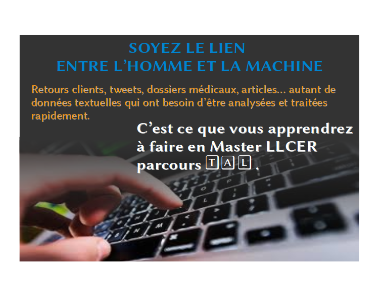
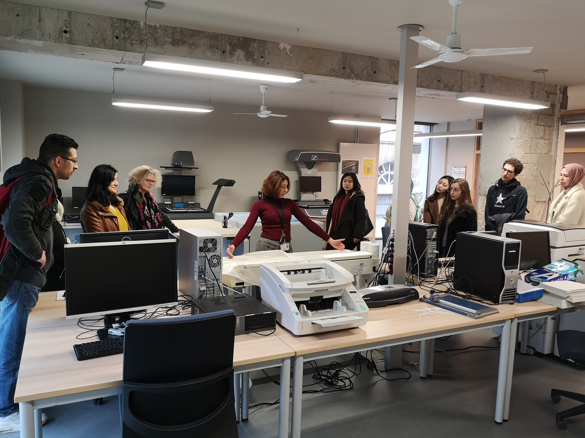

		

<h1>Master en Traitement Automatique des Langues</h1>

Le <strong>Master Traitement Automatique des Langues (TAL)</strong>, proposé au sein du 
<strong>Master LLCER - Langues, Littératures et Civilisations Étrangères et Régionales</strong> 
de l’Université Marie et Louis Pasteur, forme des <strong>spécialistes des technologies de la langue</strong>. 
Le Master TAL offre une formation interdisciplinaire combinant linguistique, informatique et réflexion critique.

Téléchargez ici la <a href="/assets/fichiers/Fiche-formation-2025.pdf" target="_blank">Fiche de la formation Master TAL (mise à jour 2025)</a>.

<h2 id="finalite">Finalité et objectifs</h2>

Le <strong>TAL</strong> est au cœur des révolutions actuelles en <strong>intelligence artificielle</strong> et en <strong>sciences du langage</strong>. 
Ce domaine vise à doter les machines de la capacité de <strong>comprendre, analyser et générer la langue humaine</strong>. 
Cela inclut aussi bien des applications grand public (assistants vocaux, traduction automatique, moteurs de recherche, 
agents conversationnels) que des enjeux industriels et scientifiques (extraction de connaissances, gestion de corpus multilingues, création de ressources linguistiques spécialisées).

Notre master se distingue par son <strong>ancrage interdisciplinaire</strong> : il associe 
linguistique, informatique et réflexion critique sur les technologies. Au-delà de l’usage des grands modèles de langage (LLM), 
les étudiants acquièrent une <strong>compréhension fine des mécanismes sous-jacents des algorithmes</strong> et une capacité d’analyse, qui sont indispensables pour anticiper les transformations de la société et du marché du travail.

<strong>Compétences clés développées au sein du Master :</strong>

<ul class="list-group mb-4">
  <li class="list-group-item"> <strong>Analyser et modéliser</strong> les phénomènes linguistiques pour les rendre exploitables par ordinateur.</li>
  <li class="list-group-item"> <strong>Traiter et formaliser</strong> des données textuelles en vue de créer des ressources linguistiques.</li>
  <li class="list-group-item"> <strong>Concevoir et évaluer</strong> des systèmes de TAL (LLMs, traduction automatique, extraction d’information, génération automatique).</li>
  <li class="list-group-item"> <strong>Créer des dictionnaires et ressources multilingues</strong> pour des applications en entreprise et en recherche.</li>
  <li class="list-group-item"> <strong>Développer un esprit critique</strong> sur l’utilisation des IA langagières et sur l’impact sociétal de ces technologies.</li>
</ul>

La formation est <strong>interdisciplinaire</strong>, elle développe des compétences en <strong>linguistique</strong>, 
<strong>langues</strong> et <strong>informatique appliquée au traitement automatique des langues</strong>. 
Elle permet aux étudiants d’acquérir à la fois des bases théoriques solides 
(langue, linguistique fondamentale, modélisation des phénomènes linguistiques) et des 
compétences pratiques adaptées aux besoins actuels du domaine. 
Les enseignements pratiques incluent la constitution et l’analyse de corpus, 
la formalisation et la structuration des données linguistiques, ainsi que 
leur implémentation dans des logiciels et systèmes. 
Les travaux dirigés et projets informatiques introduisent des notions de 
génie logiciel pour le TAL, de modélisation et représentation des données langagières, 
de résolution de problèmes et d’implémentation de langages spécialisés.  
L’ensemble est toujours conçu en lien avec des <strong>applications concrètes</strong>, qu’il s’agisse 
de traduction automatique, d’extraction d’information ou de traitement de corpus spécialisés.  
Enfin, la maîtrise de plusieurs langues naturelles est encouragée, 
car elle constitue un atout essentiel pour comprendre la diversité et la richesse des démarches en TAL.

<h2 id="organisation">Organisation de la formation</h2>

Le cursus se déroule en <strong>deux ans (M1 et M2)</strong>, soit quatre semestres, et propose une progression pédagogique
structurée : des bases théoriques solides vers une expertise appliquée. Vous y apprendrez progressivement
les modèles linguistiques et les principes fondateurs du traitement automatique des langues
(français, anglais, et autres langues naturelles), afin de comprendre et de concevoir des applications numériques
capables de traiter, analyser et générer du langage naturel.

La <strong>première année</strong> est dédiée à la consolidation d’une double compétence en
linguistique et en informatique appliquée, incluant l’acquisition des fondamentaux en
programmation, modélisation et analyse de données textuelles.  Durant cette année, vous réaliserez un mémoire de recherche, qui est un travail personnel encadré par un ou plusieurs enseignants-chercheurs. Le choix du sujet de mémoire sera fait avec vous,
en fonction de vos intérêts et de vos objectifs professionnels. <a href="memoire.html">(Plus d'informations sur le mémoire de recherche)</a>

La <strong>seconde année</strong> approfondit cette formation avec des modules spécialisés,
portant notamment sur l'IA et les grands modèles de langage (LLM), la traduction automatique,
l’extraction et la fouille d’information, ainsi que l’évaluation critique des systèmes d’IA linguistique. 
En parallèle, vous effectuerez un stage en entreprise ou dans un laboratoire de recherche.
Ce stage constitue une première expérience professionnelle significative,
vous permettant d’affronter des problématiques concrètes (industries de l’IA, édition, technologies linguistiques).
Vous aurez également la possibilité de rejoindre les projets de recherche de notre laboratoire. 

	Durant la seconde année, vous aurez le choix entre :
	

<ul class="list-group mb-4">
  <li class="list-group-item"><strong>Parcours recherche</strong> : inclut un approfondissement du mémoire de recherche, la participation aux séminaires, et permet une poursuite possible en doctorat.</li>
  <li class="list-group-item"><strong>Parcours professionnel</strong> : la priorité est donnée au stage long (6 mois) en entreprise, avec un travail appliqué sur des projets TAL en industrie.</li>
</ul>

Les <strong>séminaires hebdomadaires</strong> en semestres 8 et 10 complètent la formation et offrent un espace d’échanges avec des chercheurs en TAL (en France ou à l'international),
des doctorants et des professionnels du secteur. Ces rencontres vous permettront de connaître la recherche et les projets en TAL, de suivre les évolutions rapides du domaine, ainsi que de renforcer votre réseau par des rencontres avec des professionnels.

<strong>Modules enseignés :</strong>

La maquette de la formation est téléchargeable ici : <a href="/assets/fichiers/Master-TAL-Maquette.pdf" target="_blank">[MAQUETTE - PDF]</a>.

<h2 id="qui">Qui peut candidater ?</h2>

Le Master LLCER parcours Traitement Automatique des Langues (TAL) est ouvert à tous les candidats titulaires :

<ul>
  <li>d’une <strong>Licence (Bac+3)</strong> en langues vivantes, linguistique, sciences du langage, informatique ou mathématiques (toutes mentions et options possibles), ou d'une discipline voisine.</li>
  <li>ou d’une <strong>validation des acquis (VAE / VAP)</strong> permettant l’accès au grade de master.</li>
</ul>

Un niveau linguistique est requis : <strong>C1 en français</strong> (langue principale d’enseignement) et <strong>B2 en anglais</strong> afin de pouvoir lire des documents scientifiques et suivre les cours et séminaires intégrant une dimension internationale.  

<strong>Aucun pré-requis en informatique</strong> n’est exigé : les enseignements en programmation commencent par une <strong>initiation progressive</strong>, spécialement adaptée aux étudiants venant de formations en langues, lettres et sciences humaines.

<h2 id="inscription">Comment candidater ?</h2>

<table class="table table-bordered">
  <thead class="thead-light">
    <tr>
      <th><h3>🇫🇷 🇪🇺 Étudiants français et européens</h3></th>
      <th><h3>🌍 Étudiants internationaux</h3></th>
    </tr>
  </thead>
  <tbody>
    <tr> 
      <td>

          Les candidatures se font via la plateforme nationale 
          <a href="https://monmaster.gouv.fr/" target="_blank"><strong>Mon Master</strong></a>.
        

        <ul>
          <li>Choisir : <em>Master LLCER – Parcours Traitement Automatique des Langues (TAL)</em>.</li>
          <li>Déposer : CV, lettre de motivation, relevés de notes et diplômes.</li>
          <li>Après une vérification administrative, les dossiers sont transmis à la <strong>commission d’admission</strong> (réunie en juin).</li>
          <li><strong>Période de candidature : entre février et avril</strong> (dates exactes actualisées chaque année sur Mon Master).</li>
        </ul>

Le calendrier MON MASTER pour l'année 2026 est disponible ici : <a href="https://information.monmaster.gouv.fr/documents/3/mm26_calendrier_court_1080x1920_02_01.pdf" target="_blank">[CALENDRIER MON MASTER]</a>.

Eléments clés du dossier de candidature :

<ul>
  <li>Relevés de notes de toutes vos années d’enseignement supérieur</li>
  <li>Copies de tous vos diplômes à partir du baccalauréat</li>
  <li>Lettre de motivation claire et personnalisée (élément décisif du dossier)</li>
  <li>Curriculum vitae détaillé</li>
</ul>

<strong>Attention :</strong> Une fois votre candidature acceptée, la <strong>confirmation</strong> via la plateforme est obligatoire. Sans confirmation, vous serez considéré comme démissionnaire.

  </td>

   <td>
   		

          Les procédures passent par <a href="https://www.campusfrance.org" target="_blank"><strong>Campus France</strong></a>.  
        

        

          N’attendez pas : les démarches doivent être initiées <strong>dès janvier</strong> pour une entrée en Master à la rentrée suivante.
        

   </td>

   </tr>
  </tbody>
</table>
  

Pour tout renseignement complémentaire, contactez la responsable de la formation : Pr Iana ATANASSOVA (<a href="mailto:iana.atanassova@umlp.fr">iana.atanassova@umlp.fr</a>).

Pour plus de détails sur l'inscription et la liste des documents
 à fournir, vous pouvez contacter également le service de scolarité de <a href="http://www.univ-fcomte.fr/pages/fr/menu1/formations/inscription/inscription---scolarites-17.html#UFR_SLHS" target="_blank">l'UFR Sciences du Langage, de l’Homme et de la Société (SLHS)</a> de l'Université Marie et Louis Pasteur.

<h2 id="pourquoi">Pourquoi choisir ce Master ?</h2>

<ul class="list-group list-group-flush mb-4">
  <li class="list-group-item">Un diplôme reconnu en Europe et à l’international, adossé à un laboratoire de recherche réputé (le CRIT - Centre de Recherches Interdisciplinaires et Transculturelles).</li>
  <li class="list-group-item">Un encadrement personnalisé par des enseignants-chercheurs experts en TAL, IA et linguistique.</li>
  <li class="list-group-item">Une formation en TAL qui n'exige pas de pré-requis en informatique, adaptée aux étudiants en sciences humaines.</li>
  <li class="list-group-item">Des partenariats avec les entreprises du domaine (startups, PME spécialisées, grands groupes internationaux).</li>
  <li class="list-group-item">Une immersion dans des projets de recherche innovants dès le M1.</li>
  <li class="list-group-item">Une formation aux <strong>grands modèles de langage</strong> et aux applications de l’IA les plus récentes.</li>
</ul>

<h2 id="carriere">Perspectives de carrière</h2>

Ce Master ouvre sur une large variété de carrières, en France comme à l’international :

  

    <strong>Industrie de l’IA</strong> 
    Développement et évaluation de systèmes basés sur l’IA, grands modèles de langage (LLM), dialogue homme-machine.
  

  

    <strong>Édition & logiciels</strong> 
    Traduction, outils linguistiques (correcteurs, dictionnaires numériques, analyse textuelle).
  

  

    <strong>Recherche & doctorat</strong> 
    Possibilité de poursuite en doctorat, insertion dans des laboratoires de recherche en France et à l’international.
  

Parmi nos diplômés, certains exercent comme linguistes-informaticiens, 
ingénieurs R&D ou chefs de projets IA/TAL. 
D’autres ont créé leur propre entreprise dans le domaine du TAL et des technologies du langage.

Pour plus d'informations vous pouvez consulter <a href="http://www.rncp.cncp.gouv.fr/grand-public/visualisationFiche?format=fr&amp;fiche=16084" target="blank_">la fiche de la formation au Répertoire National des Certifications Professionnelles (RNCP)</a>.

<h2 id="entreprises">Les entreprises parlent de nos étudiants en stage</h2>

	

		"L'étudiant possède d'excellentes qualités personnelles et 
professionnelles. Sérieux, efficace et impliqué, il a su donner le
		meilleur de lui-même et s'est toujours montré réceptif et 
autonome. De plus, il se distingue par la qualité de son travail. Un
		stagiaire exemplaire !"
	

	
Université de Bourgogne, 2022

	

		"L'étudiante a effectué un travail sérieux et rigoureux. 
Ponctuelle et volontaire, son autonomie lui a permis de progresser sur
		les approches par apprentissage automatique et de mettre en oeuvre
ses compétences en linguistiques, en
		particulier sur le volet « évaluation »."
	

	
Université de Nantes, 2022

	

		"L'étudiante s’est bien intégrée au pôle Data et à la team 
R&amp;D, à la fois au niveau relationnel et en ce qui concerne les 
process de l’équipe. Elle s’est montrée très curieuse, disposée à 
apprendre et acquérir de nouvelles compétences. Malgré les différents 
défis d’une mission avec un haut niveau de technicité, Florine a réussi à
acquérir des notions compliquées et a su les appliquer. Elle possède de
bonnes capacités d’écoute, mais elle peut encore s’améliorer au niveau 
de l’autonomie et dans le transfert d’apprentissage."
	

	
Namkin, 2023

	

		"The trainee have made significant contributions and demonstrated a
commendable level of skill and commitment in her work. They 
successfully developed a preprocessing pipeline for extracting text from
industrial documents, which is a crucial task in information 
extraction.
		Their involvement in revising and formulating annotation 
guidelines displays their attention to detail and understanding of data 
preparation for training and testing purposes. Furthermore, the trainee 
demonstrated excellent interpersonal skills and fostered strong 
relationships with their team members. Their ability to effectively 
communicate and articulate their novel ideas played a significant role 
in driving collaboration and understanding within the team. Clear and 
effective communication is crucial in a research and development 
environment, and the trainee's proficiency in this area positively 
affected their overall performance."	
	

	
Technologies Austria AG, 2023

					

						"L'étudiante a fait preuve depuis le début de son stage de 
beaucoup d’intérêt et de motivation, ce qui lui a permis d’adopter 
rapidement les outils/procédés et organisation de l’entreprise. Elle a 
su collaborer efficacement avec toutes les équipes techniques et a su 
gagner leur confiance."
					

					
Lingua Custodia SAS, 2023

				

<h2 id="faq">FAQ - Master TAL</h2>

<h4>Comment candidater au Master « Traitement Automatique des Langues (TAL) » ?</h4>

Pour les étudiants français titulaires d'une Licence obtenue en France, la candidature s’effectue via la plateforme nationale <strong>Mon Master</strong> (<a href="https://candidature.monmaster.gouv.fr/" target="_blank">candidature.monmaster.gouv.fr</a>), qui ouvre généralement <strong>entre février et avril</strong> (dates exactes actualisées chaque année sur Mon Master).

Votre dossier devra contenir un <strong>curriculum vitae</strong>, une <strong>lettre de motivation</strong>, les <strong>relevés de notes</strong> de votre Licence ainsi que votre <strong>diplôme</strong>.

Pour les étudiants étrangers ne disposant pas d’un diplôme français, il est nécessaire de déposer votre candidature via la plateforme <strong>Campus France</strong> (<a href="https://www.campusfrance.org/fr" target="_blank">campusfrance.org</a>), en vous renseignant auprès d’eux dès le mois de janvier.

<h4>Comment est l'insertion professionnelle après le Master ? Faut-il envisager une formation complémentaire ?</h4>

Le Master TAL est conçu pour favoriser une insertion professionnelle rapide. La majorité de nos diplômés trouvent un emploi dans les mois qui suivent leur sortie, grâce notamment au stage de 6 mois effectué en deuxième année, véritable point d’appui pour leur premier emploi.

Le secteur du traitement automatique des langues est en forte croissance et très recherché dans le privé, notamment dans les grandes villes comme Paris, Lyon ou Toulouse. Toutefois, la concurrence est importante, et une implication soutenue ainsi qu’un travail personnel rigoureux sont indispensables pour développer des compétences solides. Le secteur est très dynamique et les compétences recherchées par les entreprises évoluent vite ces dernières années. Ainsi, la capacité d'adaptation et le dynamisme des étudiants diplômés sont des qualités importantes qui favoriseront l'insertion professionnelle rapide.

Par ailleurs, les meilleurs étudiants ont la possibilité de poursuivre en doctorat, souvent financé par contrat, au sein de notre centre de recherche ou dans d’autres laboratoires en France.

<h4>Quand et comment initier les démarches pour des séjours Erasmus à l'étranger ?</h4>

Bien que la mobilité Erasmus soit une option administrative, nous déconseillons généralement de partir à l’étranger durant ce Master, qui se déroule sur une période courte (3 semestres + stage). Passer un semestre hors de la formation risquerait de nuire à la cohérence de votre parcours et à l’acquisition des compétences clés.

Cela étant dit, tout dépend de votre capacité d'adaptation et de votre organisation personnelle. Si vous souhaitez néanmoins partir en Erasmus, les démarches doivent être engagées dès le début de l’année universitaire pour prévoir un départ au semestre 9 du Master. Nous travaillons avec plusieurs universités partenaires et pourrons vous renseigner dès la rentrée.

<h4>À quel moment faut-il choisir un sujet pour le mémoire de recherche ?</h4>

Le mémoire constitue un travail de recherche essentiel, mené tout au long de la première année du Master, et également en deuxième année si vous choisissez le parcours recherche. Les sujets sont généralement choisis entre octobre et novembre, en collaboration avec les enseignants qui vous encadreront.

Ce travail se déroule sur un temps long et fait l’objet de présentations régulières pour suivre son avancement.
Les étudiants bénéficient d’un accompagnement étroit et individuel tout au long du processus, qui repose sur un véritable travail collaboratif, dès le choix du sujet.

<h2 id="contact">Contactez-nous</h2>

Pour tout renseignement complémentaire sur les inscriptions contactez la responsable de la formation : Pr Iana Atanassova, <a href="mailto:iana.atanassova@umlp.fr">iana.atanassova@umlp.fr</a>.

Site web du CRIT : <a href="https://crit.umlp.fr/" target="_blank">https://crit.umlp.fr</a>

<a href="#" class="list-group-item active">Master TAL</a>
<a href="#finalite" class="list-group-item">Finalité et objectifs</a>
<a href="#organisation" class="list-group-item">Organisation</a>
<a href="#qui" class="list-group-item">Qui peut candidater ?</a>
<a href="#inscription" class="list-group-item">Comment candidater ?</a>
<a href="#pourquoi" class="list-group-item">Pourquoi choisir ce programme ?</a>
<a href="#carriere" class="list-group-item">Perspectives de carrière</a>
<a href="#entreprises" class="list-group-item">Les entreprises parlent de nos étudiants en stage</a>
<a href="#faq" class="list-group-item">FAQ</a>
<a href="#contact" class="list-group-item">Contactez-nous</a>
<a href="/edt.html" class="list-group-item">Emplois du temps</a>

